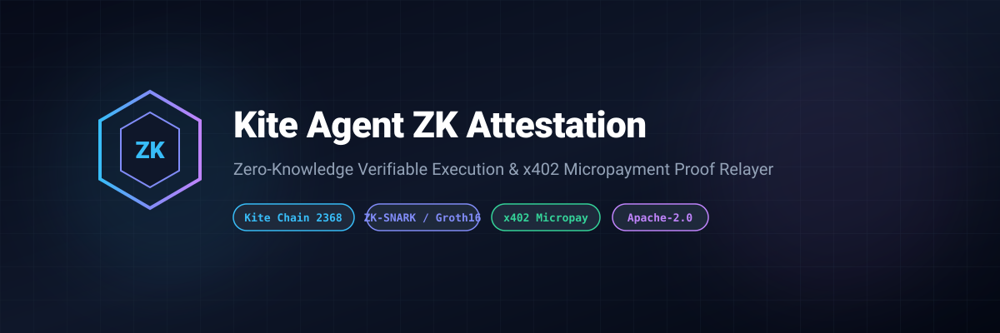
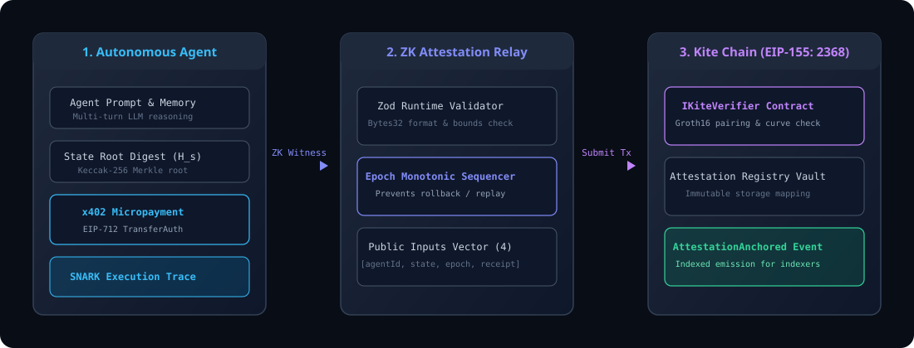

# Kite Agent ZK Attestation Protocol



[](LICENSE)
[](https://www.typescriptlang.org/)
[-0284c7)](https://gokite.ai)
[](https://gokite.ai)

> **Zero-Knowledge verifiable off-chain agent state attestation protocol & x402 payment proof relayer on Kite Chain.**

---

## 🌟 Overview

Autonomous AI Agents operating in decentralized swarms require verifiable execution integrity without exposing proprietary weights, prompts, or sensitive internal state data.

**`kite-agent-zk-attestation`** provides:
- **Groth16 / Snark Verifier**: On-chain cryptographic validation of off-chain AI reasoning batches.
- **Monotonic Epoch Sequencer**: Rollback-proof and replay-resistant sequence tracking per Agent ID.
- **x402 Micropayment Linkage**: Cryptographically couples EIP-712 payment authorization receipts with verifiable computation digests.
- **Dual Network Support**: Pre-configured for Kite Testnet (EIP-155: `2368`) and Kite Mainnet (`2366`).

---

## 🏗️ Architecture



The attestation flow comprises three decoupled layers:
1. **Autonomous Agent Layer**: Runs complex off-chain multi-turn reasoning, accumulates state digests, and executes micropayments via EIP-712 TransferWithAuthorization (x402).
2. **Attestation Relay Layer**: Normalizes zero-knowledge witness proofs, asserts monotonic epoch increments, formats 4-slot public inputs, and communicates with Kite Chain RPC.
3. **Kite Chain Protocol Layer (EIP-155: 2368/2366)**: Executes EVM pairing curve checks via `IKiteVerifier` and emits `AttestationAnchored` events for real-time telemetry indexing.


---

## 🚀 Quick Start

### Installation

```bash
git clone https://github.com/Anyi-zheng/kite-agent-zk-attestation.git
cd kite-agent-zk-attestation
npm install
```

### Build & Test

```bash
npm run test
npm run build
```

---

## 📜 Smart Contract Interface

Contract deployed on Kite Testnet (`0x89C57532A1553fbe98A008Fe3960098f9E7C0572`):

```solidity
function anchorAttestation(
    bytes32 agentId,
    bytes32 stateHash,
    uint256 computationEpoch,
    bytes32 x402ReceiptHash,
    bytes calldata zkProof
) external returns (bytes32 attestationHash);
```

---

## 📄 License

Licensed under the Apache License, Version 2.0. See [LICENSE](LICENSE) for details.
